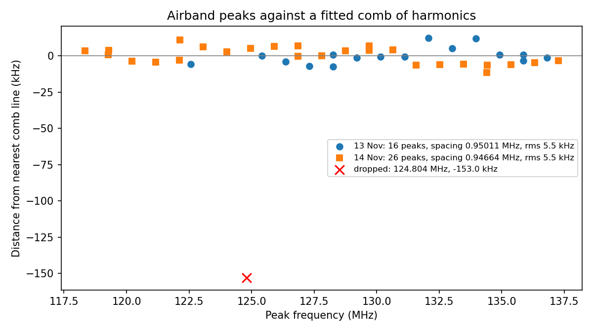

# rtlsdr-lab

RTL-SDR and GNU Radio experiments: FM first, then airband AM, then ACARS. Predictions are written before each run and scored afterwards, misses included.

AI-assisted: scripts and this README were drafted with Claude. I ran every command and checked the output.

## Setup used

- Dongle: Realtek RTL2832U, tuner Rafael Micro R820T (found by `SoapySDRUtil --find`). Probe range 24 to 1764 MHz, sample rates up to 3.2 MS/s. The case label reads RTL-SDR.COM V.3, RTL2832U R860T TCXO+BIAS T+HF, while the driver reports an R820T, and I cannot tell whether this unit is a genuine V3. It is a stick plugged straight into the laptop's USB port, with a short white stub aerial on a right-angle SMA adapter, upright, about 10 cm by eye.
- Windows 11 with WSL2 (Ubuntu), GNU Radio 3.10.12, SoapySDR RTL-SDR module. No `gr-osmosdr`, the Soapy source block is used instead.
- The dongle is passed into WSL with usbipd-win 5.3.0. Admin PowerShell, once: `usbipd bind --busid 1-1`. Normal PowerShell, each time: `usbipd attach --wsl --busid 1-1`. Check the bus ID with `usbipd list` first, other devices on the machine must stay unbound.
- Scripts run with `/usr/bin/python3` (the system one GNU Radio uses), not a venv.

## Commands

Capture 3 s of raw IQ at 98 MHz, 2.048 MS/s, tuner gain 30 dB:

    /usr/bin/python3 capture.py 98e6 2.048e6 30 3 captures/fm_98M_run1.cfile

Plot spectrum and waterfall:

    /usr/bin/python3 plot_spectrum.py captures/fm_98M_run1.cfile 98e6 2.048e6 30 figures/fm_98M_run1_spectrum.png

`captures/` is git-ignored (49 MB per 3 s capture).

## Result so far

`figures/fm_98M_run1_spectrum.png`: three broad peaks about 200 kHz wide, near 97.75, 98.69 and 98.91 MHz (read by eye from the figure). The top one has a shoulder near 98.86 MHz. A thin steady spike near 98.30 MHz, cause unknown. Only the peak near 98.9 MHz was later confirmed as a station, see the section on later captures. One `[R82XX] PLL not locked!` warning appeared during the capture, the stations were present anyway, and I have one capture only.

Peak counter fixed: `plot_spectrum.py` now takes the threshold as an optional sixth argument (default 10 dB) and prints and plots the value used. At 10 dB it lists 4 peaks: 97.743, 98.300, 98.695 and 98.908 MHz (17.1, 16.5, 16.3 and 20.8 dB above the floor). Three are broad, and later captures confirm only the one near 98.9 MHz as a station. The 98.300 MHz one is the thin spike, which I count as a peak but not as a station. The 10 dB value was chosen after seeing the first figure, so it is not a tested threshold.

## Later captures at 98 MHz (same setup, antenna on unless stated)

Run 2 repeated run 1 and the four peaks came back with heights within 1.1 dB of run 1. Some things are established and one is not.

Established:

- 98.9 MHz is a stereo FM broadcast station. Demodulated, it shows audio up to a sharp cutoff at 15 kHz, a 19 kHz pilot tone 29.0 dB above the nearby floor (29.7 dB with the filter centred on 98.900 MHz) and a stereo band around 38 kHz (`figures/fm_98M_run1_pilot.png`, `figures/fm_98M_run1_pilot_grid.png`). I listened to 3 s WAV files for 97.743, 98.695 and 98.908 MHz: one had music and two had nothing audible. I did not record which file had the music. I assumed it was 98.908, which is the loudest (RMS 0.158 against 0.092 and 0.093).
- The 98.30 MHz spike and the two broad peaks disappear with the antenna removed (`figures/fm_98M_noant_spectrum.png`), so they come in through the antenna. The small spike at exactly 98.000 MHz stays, so it is internal to the dongle.
- The 98.9 MHz station, the 98.30 MHz spike and the first broad peak fall by about 12 dB and then about 8 dB when the tuner gain goes from 30 to 20 to 10 dB (levels read by eye from the figures, about 0.5 dB). I expected tuner overload to fall much faster than that, which is from memory and not checked. So overload is ruled out for those three signals. The second broad peak was not read this way.

Not explained:

- The two broad peaks, about 200 kHz wide and about 0.95 MHz apart. In run 1 they sat near 97.74 and 98.70 MHz. In run 2, the gain 20 and gain 10 captures and the battery capture they sat at 97.86 to 97.88 and 98.80 to 98.82 MHz, with the same spacing. The 98.9 MHz station and the 98.30 MHz spike did not move. In the run 1 data their envelope is nearly constant (spread 0.19 and 0.23, against 0.55 for noise) and their frequency spread is about 26 kHz, but demodulating them gives no audible audio and no 19 kHz pilot. When I wrote this I did not know what they were. The airband survey below gives a probable explanation (a harmonic comb from one source), which is not a confirmed cause. A capture on battery power, with the charger unplugged, did not change them, so the charger is not supported as the source.

The envelope and frequency-spread numbers come from `fm_checks.py`, which reproduces them exactly:

    /usr/bin/python3 fm_checks.py captures/fm_98M_run1.cfile 98e6 2.048e6 97.400e6 97.743e6 98.695e6 98.908e6

The WAV files for the listening check come from `fm_wav.py`, which regenerates them byte for byte (3 s of mono audio per station, one shared volume scale):

    /usr/bin/python3 fm_wav.py captures/fm_98M_run1.cfile 98e6 2.048e6 captures/wavcheck 97.743e6 98.695e6 98.908e6

What is still not saved is the listening itself: I did not record which file had the music, and I assumed it was 98.908 MHz. `demod_fm.py` is saved:

    /usr/bin/python3 demod_fm.py captures/fm_98M_run1.cfile 98e6 2.048e6 30 figures/fm_98M_run1_pilot.png 97.743e6 98.695e6 98.908e6

Other figures: `figures/fm_98M_run2_spectrum.png`, `figures/fm_98M_g20_spectrum.png`, `figures/fm_98M_g10_spectrum.png`, `figures/fm_98M_battery_spectrum.png`.

## Airband survey and a comb of lines (13 Nov 2026)

Question: can the dongle hear anything in the airband (118 to 137 MHz)? I took 13 captures of 1 s each, centred every 1.5 MHz from 118.5 to 136.5 MHz, antenna on, tuner gain 40 dB, 2.048 MS/s, and ran `plot_spectrum.py` with the 10 dB threshold on each. The 13 Nov run used this loop typed inline. It is now saved as `survey_air.sh` (first run from the script on 14 Nov, below):

    for c in 118.5 120.0 121.5 123.0 124.5 126.0 127.5 129.0 130.5 132.0 133.5 135.0 136.5; do
      /usr/bin/python3 capture.py ${c}e6 2.048e6 40 1 captures/air_$c.cfile
      /usr/bin/python3 plot_spectrum.py captures/air_$c.cfile ${c}e6 2.048e6 40 /tmp/air_$c.png 10
    done

Result: 16 peaks in total, none at 118.5, 120.0, 121.5 and 124.5 MHz. The peak frequencies are in `data/air_survey_2026-11-13.txt`, typed by hand from the terminal output.

The peaks are not random. `comb_fit.py` fits integer harmonics of one spacing to them:

    /usr/bin/python3 comb_fit.py data/air_survey_2026-11-13.txt

- Best spacing 0.95011 MHz, residual 5.5 kHz rms. In 20 random sets of 16 frequencies over the same range, the best residual was 164 kHz or worse (median 204 kHz). The control used a coarser search step than the real fit.
- The fit assigns harmonic numbers 129 to 144. It then predicts the two broad peaks in the FM band (harmonics 103 and 104) to within 7 and 9 kHz of where the later captures put them (averages of the run 2, gain 20 and battery captures for the first, run 2 and battery for the second).
- The run 1 positions of those two peaks fit the same harmonics if the spacing was about 1.1 kHz lower (0.94896 and 0.94899 MHz). That would explain why both moved together by about 110 kHz between run 1 and run 2.

This makes the broad peaks, and every airband peak in this survey, look like harmonics of one radiated source with a spacing near 0.95 MHz. They are consistent with the earlier results (constant envelope, no audio, gone with the antenna off). I have not identified the source. Limits:

- The fit gives the spacing. The true fundamental could be a sub-multiple, such as half of it, with every second line weak.
- The battery capture ruled out the laptop charger. I do not know what else nearby produces it.
- The airband peaks were not tested at other gain settings, so tuner overload is not excluded there.
- All 16 peaks are accounted for by the comb, so I found nothing I can attribute to an aircraft. The survey was 1 s per frequency with a 10 dB threshold, so weak or intermittent transmissions would be missed.

## Airband survey repeated, and the comb again (14 Nov 2026)

Question: is the comb still there a day later, and is the spacing the same? I ran the same survey from the saved script `survey_air.sh` (gain 40 dB, 10 dB threshold, antenna on). It listed 27 peaks, copied by hand from the terminal output into `data/air_survey_2026-11-14.txt`.

- Fit over 0.94 to 0.96 MHz with all 27 peaks: spacing 0.94660 MHz, 29.4 kHz rms. One peak, 124.804 MHz, is 147.5 kHz from the nearest comb line. The next worst is 16.3 kHz.
- Dropping that peak and refitting: 26 peaks, spacing 0.94664 MHz, 5.5 kHz rms (the same as 13 Nov). With the default 0.90 to 1.00 range and nothing dropped, the fit gives the same 0.94660 MHz and 29.4 kHz.
- Random control with the same drop-the-worst rule: median 221 kHz, minimum 202 kHz.
- The spacing moved from 0.95011 MHz (13 Nov) to 0.94664 MHz (14 Nov), 3.5 kHz lower. The monitor test above saw the spacing wander between about 0.940 and 0.952 MHz, so this is a change of the same kind. I did not find what sets it.
- Four lines are new at the bottom of the band (118.334, 119.28, 120.220 and 121.166 MHz). The 13 Nov captures at 118.5, 120.0 and 121.5 MHz listed none. I do not know why.

`comb_plot.py` makes the figure. Against the refit spacing the dropped peak is 153.0 kHz off (147.5 kHz against the first fit), about 13 times the largest distance of any kept peak.

Is the 124.804 MHz peak steady? I took three more 1 s captures at 124.5 MHz, gain 40. The comb line at 124.962 MHz was listed in all three. The 124.804 MHz peak was listed in two (12.6 and 12.0 dB), at the same frequency both times, and not in the third. It may have been under the 10 dB threshold there; I did not check. So it repeats and sits off the comb. I did not identify it. My predictions for this test: 124.962 MHz in all three (held), 124.804 MHz in at most one of three (missed), in all three (missed).

Limits:

- I dropped the outlier after seeing it. The random control used the same rule, so it still separates a real comb from a random one, but 5.5 kHz means "after dropping the worst of 27".
- The control used a coarser step than the real fit.
- Two surveys on two days, one antenna, one location. The source of the comb is still unidentified.

Reproduce:

    /usr/bin/python3 comb_fit.py data/air_survey_2026-11-14.txt --drop-worst --range 0.94 0.96
    /usr/bin/python3 comb_plot.py figures/comb_residuals.png

## ACARS band look (13 Nov 2026)

Question: is there ACARS traffic the dongle can see? ACARS is an aircraft VHF data link, vertically polarised. I took the channel list from web sources and have not confirmed any channel on air. 131.725 MHz is listed as the European primary and 131.525 MHz as the European secondary. Two national aeronautical circulars (Spain, `aip.enaire.es/AIP/contenido_AIC/I/LE_Circ_2023_I_10_en.pdf`, and Norway, `partner.avinor.no/siteassets/ais-portalen-forside/aic/en_circ_2024_a_015_en.pdf`) list 131.525, 131.725 and 131.825 MHz as the ACARS channels. Informal listings also give 131.550 MHz as a world primary and 131.850 MHz as a newer European channel, which the circulars do not mention. The polarisation comes from `sigidwiki.com/wiki/Aircraft_Communications_Addressing_and_Reporting_System_(ACARS)`.

Capture 1: 60 s centred on 131.625 MHz at 0.3 MS/s, tuner gain 40 dB, antenna on, then a burst count in a 12 kHz window on each channel in 10 ms blocks (a burst is 10 dB or more above that channel's own median for at least 100 ms). 131.625 and 131.675 MHz are controls, because no listing I found gives them as ACARS channels:

    /usr/bin/python3 capture.py 131.625e6 0.3e6 40 60 captures/acars_131625_60s.cfile
    /usr/bin/python3 channel_bursts.py captures/acars_131625_60s.cfile 131.625e6 0.3e6 10 131.525 131.550 131.625 131.675 131.725

Result: 0 bursts on all five channels. That is one minute at one antenna position, so it does not show that there is no traffic: a burst shorter than 100 ms or weaker than 10 dB would be missed. Every channel had one 10 ms block 7.3 to 8.4 dB above its median, and I did not check whether those coincide. The median at 131.725 MHz was 2.1 dB above the other four, which agree to 0.2 dB.

Two 20 s spectra with a 3 dB peak threshold, one centred on 131.625 MHz and one on 131.575 MHz (`figures/acars_131625_20s_spectrum.png` and `figures/acars_131575_20s_spectrum.png`; the first is the first 20 s of capture 1):

- A thin spike at 131.549 MHz (4.0 and 5.0 dB above the floor), at the same frequency in both, so it is not tied to the centre frequency. It is within 1 kHz of 131.550 MHz. It is not on the comb at the spacing fitted in the airband survey (131.549 divided by 0.95011 is 138.46), but the comb spacing varies (see the monitor test section), so that check is weaker than it looked. The spike stayed within 1 kHz in two captures at different times while the comb lines moved by tens of kHz within minutes, so I still do not think it is a comb line. I do not know what it is. It is steady in a 20 s average, which does not look like ACARS bursts, but I have not measured how steady it is.
- A broad rise of about 3 dB, peaking about 100 to 120 kHz above the centre in both captures (near 131.745 MHz, then near 131.68 MHz, read by eye). It moves with the centre, so I read it as the dongle's own response and not a signal. That would also explain the higher median at 131.725 MHz.
- Horizontal streaks across the full width in both waterfalls, which fit wideband impulses. I have not tested that.

Limits: this is energy detection only, and no ACARS message has been decoded. 131.825 MHz was outside both captures. The airband peaks from the survey were not gain-tested, and I have not tried a different antenna position.

## Monitor on and off test (14 Nov 2026)

Question: is the external monitor the source of the broad peaks? The dongle is a stick in the laptop's USB port and cannot be moved, so I switched the monitor off and on instead. Three 3 s captures at 98 MHz, 2.048 MS/s, tuner gain 30 dB, with the 5 dB peak threshold, roughly a minute apart (my estimate from the 45 s waits): A with the monitor on, B with it switched off, C with it switched on again. I do not know whether the monitor was fully off (not in standby) for B. Each capture was:

    /usr/bin/python3 capture.py 98e6 2.048e6 30 3 captures/fm_98M_mon_A.cfile
    /usr/bin/python3 plot_spectrum.py captures/fm_98M_mon_A.cfile 98e6 2.048e6 30 figures/fm_98M_mon_A_spectrum.png 5

Peaks listed by the script, in dB above the floor:

| Capture | Hump 1 | Hump 2 | 98.90 MHz station | 98.30 MHz spike |
| --- | --- | --- | --- | --- |
| A, monitor on | 97.166 MHz, 14.7 | 98.109 MHz, 15.0 | 98.906 MHz, 15.1 | 98.303 MHz, 16.6 |
| B, monitor off | 97.186 MHz, 15.4 | 98.126 MHz, 15.6 | 98.903 MHz, 14.7 | not listed (about 4 dB by eye) |
| C, monitor on again | 97.207 MHz, 16.1 | 98.151 MHz, 16.0 | 98.904 MHz, 14.6 | not listed (about 4 dB by eye) |

Figures: `figures/fm_98M_mon_A_spectrum.png`, `figures/fm_98M_mon_B_spectrum.png`, `figures/fm_98M_mon_C_spectrum.png`.

- The humps did not change when the monitor went off. Their height relative to the station changed by about 1 dB from A to B and did not reverse when the monitor came back on. So the monitor is not supported as the source of the humps. It is not ruled out either, because I do not know it was fully off.
- The 98.30 MHz spike fell from 16.6 dB to about 4 dB in B and stayed down in C, so it did not follow the monitor. I do not know why. It had been present at 13 to 17 dB in every earlier capture at gain 30 with the antenna on.
- Both humps moved up in frequency by about 20 kHz per capture (97.166, 97.186, 97.207 and 98.109, 98.126, 98.151 MHz). The gap between them was 0.943, 0.940 and 0.944 MHz. An earlier capture, taken before the monitor test with nothing switched off and with the time not recorded (`figures/fm_98M_all_on_spectrum.png`), has them at about 97.00 and 97.94 MHz, 0.94 MHz apart (read by eye). Run 1 and run 2 had 0.952 and 0.946 MHz.

So the line spacing has ranged from about 0.940 to 0.952 MHz and the lines move by tens of kHz within minutes. A fixed crystal would not do that. I have not tested what does. A source whose frequency depends on load or temperature, such as a switching power converter, would fit, but that is a guess.

This weakens two earlier statements. The comb fit in the airband survey describes one moment. Near 131 MHz, a spacing change of 0.012 MHz moves a line by about 1.7 MHz (140 times 0.012), more than the spacing itself, so the claim that the ACARS channels sit between the lines held at survey time only. The check that the 131.549 MHz spike is not on the comb has the same limit.

Limits: three captures and one off period. Hump frequencies come from the script's peak list. The spike heights in B and C and the frequencies in the earlier capture are read by eye.

## GNU Radio flowgraph, FM (14 Nov 2026)

So far GNU Radio had only been used as a library (the Soapy source block in `capture.py`) and all analysis was numpy and scipy. `gr_fm.py` is the first flowgraph: file source, frequency-translating decimating FIR filter (100 kHz cutoff, 247 taps from GNU Radio's own filter design, decimation 8), quadrature demodulator, file sink. It reads a saved capture, so it needs no dongle:

    /usr/bin/python3 gr_fm.py captures/fm_98M_run1.cfile 98e6 2.048e6 98.908e6 captures/gr_fm_98908.f32

Result: 767,800 output samples (768,000 from 6,144,000 divided by 8, minus the 200 trimmed) and a 19 kHz pilot 29.0 dB above the nearby floor at 98.908 MHz, the same as the numpy path in `demod_fm.py` (29.0 dB). It ran in 2.1 s.

Limits: this shows the flowgraph tunes the right station and demodulates it. It is a weak check of the channel filter, because the pilot at 19 kHz sits far inside the passband and barely depends on the filter edge. I compared one station in one capture, did not compare the two demodulated signals sample by sample, and did not listen to the output. The AM flowgraph below is tested on a synthetic file only, and nothing from the dongle goes through a flowgraph beyond the Soapy source block.

## GNU Radio flowgraph, AM, synthetic test (14 Nov 2026)

There is no off-air AM capture yet, so `gr_am.py` checks the demodulator on a signal it generates itself: 3 s at 0.3 MS/s, a carrier at +20 kHz with a 1 kHz tone at a chosen modulation depth, plus complex Gaussian noise (rms 0.005 against a mean carrier amplitude of 0.5, fixed seed). The flowgraph is a file source, a frequency-translating low-pass filter (5 kHz cutoff, 2 kHz transition, decimation 10), a magnitude block (the envelope detector) and a file sink. The script then measures the recovered depth (tone amplitude divided by the mean of the output), the tone frequency and the second harmonic:

    /usr/bin/python3 gr_am.py 0.5 1000 20000
    /usr/bin/python3 gr_am.py 1.2 1000 20000

Results:

| Input depth | Recovered depth | Tone peak | Second harmonic | Samples |
| --- | --- | --- | --- | --- |
| 0.50 | 0.502 | 999.8 Hz | 81.6 dB below the tone | 89,500 |
| 1.20 | 1.053 | 999.8 Hz | 21.9 dB below the tone | 89,500 |

The second row is overmodulation, which an envelope detector cannot follow, because the envelope goes negative and the detector returns its absolute value. I included it as a check that the test can fail, and it did: the distortion shows up as a much larger second harmonic. I worked out beforehand that this case should give a depth near 1.05 and a second harmonic about 22 dB down, and both held.

Limits: synthetic signal only, one noise level, one seed, one tone frequency and one carrier offset. This shows the envelope detector and the translating filter behave correctly on a signal I generated. It says nothing about real AM reception, about the dongle, or about how the demodulator copes with a real airband signal.

## Airband AM look: Glasgow ATIS (14 Nov 2026)

Question: can the dongle hear a continuous airband AM broadcast? I searched for the Glasgow Airport ATIS frequency. The sources disagree by 5 kHz: 129.580 MHz (`sprinkle.com/airport/EGPF`, `metarcentral.com/airport/EGPF/charts`) and 129.575 MHz (`world-airport-codes.com/united-kingdom/glasgow-international-2591.html`, `airspacesafety.com/fmc_atis_a5_09-2025`), and a fifth gives 129.57 (`skyvector.com/airport/EGPF/Glasgow-Airport`). I did not confirm which is right, or that it is on air. None of the frequencies I found is within 10 kHz of any of the 16 airband survey peaks, and two survey captures (centred on 129.0 and 130.5 MHz) covered 129.575 MHz and listed nothing there.

Captures: 20 s at 0.3 MS/s, tuner gain 40 dB, antenna on. The centre was offset from the target so the dongle's own centre artifact would not hide a carrier: 129.625 MHz (`figures/air_atis_20s_spectrum.png`) and then 129.525 MHz (`figures/air_atis_b_20s_spectrum.png`), with a 3 dB peak threshold:

    /usr/bin/python3 capture.py 129.625e6 0.3e6 40 20 captures/air_atis_20s.cfile
    /usr/bin/python3 plot_spectrum.py captures/air_atis_20s.cfile 129.625e6 0.3e6 40 figures/air_atis_20s_spectrum.png 3

Result: no carrier line at either spelling in either capture. Nothing was heard. This does not show the ATIS is not on air: a weak carrier under the noise and a short indoor aerial are both possible, and I did not demodulate or listen to anything.

Two features appeared instead:

- A thin spike at 129.600 MHz, at the same frequency in both captures (25 kHz below and 75 kHz above the centre), so it is not the dongle's centre artifact. With the aerial unscrewed it stayed (6.9 dB above its neighbours; the script does not print absolute levels), so it is internal to the dongle or its surroundings. I noticed afterwards that 129.600 MHz is nine times 14.4 MHz, half the 28.8 MHz the RTL2832U samples at (the V3 datasheet at `mouser.com/datasheet/2/813/RTL_SDR_Blog_V3_Datasheet-3305974.pdf`), which would fit a clock spur. I spotted that after seeing the number, so it is a lead and not a result.
- A broad hump about 100 kHz wide near 129.57 to 129.59 MHz, about 8 dB above the span edges by eye in the first capture. It moved about 20 kHz (by eye) when the centre moved 100 kHz, so it is not simply tied to the centre. It was gone with the aerial off. That is too wide for an AM voice channel, and I do not know what it is.

`hump_spike.py` measures both against the span edges and the local neighbours, for captures centred at 129.525 MHz only:

    /usr/bin/python3 hump_spike.py captures/air_atis_b_20s.cfile 129.525e6 0.3e6

| Capture | Hump above span edges | Spike above neighbours | Edge level |
| --- | --- | --- | --- |
| Second capture (aerial on) | 8.8 dB | 1.9 dB | -91.3 dB |
| Aerial on, repeat | 7.3 dB | 2.0 dB | -90.6 dB |
| Aerial off | 0.7 dB | 6.9 dB | -100.7 dB |
| Aerial back on | 4.0 dB | 1.9 dB | -89.3 dB |

The hump varied from 4.0 to 8.8 dB across the three aerial-on captures, so one capture of it is not a stable number. With the aerial off the floor fell by about 10 dB. The last three captures were about a minute apart with the aerial unscrewed and screwed back on, and I did not hold its position fixed.

Limits: four captures, one place, one aerial. The frequency sources disagree by 5 kHz. Everything about the hump is by eye except the table.

## Prediction scorecard

| Prediction | Result |
| --- | --- |
| Dongle shows status OK after plug-in | Miss (it was unplugged, status Unknown) |
| Driver on interface 0 is WinUSB | Hit (Zadig had already set it) |
| `rtl_test` not on the Windows PATH | Hit |
| GNU Radio not installed | Miss (it is in WSL) |
| `osmosdr` Python module missing | Hit |
| `librtlsdr` not installed in WSL | Miss (`librtlsdr2` is installed) |
| `usbipd bind` works on a WinUSB device | Hit |
| Soapy probe fails on USB permissions | Miss (it opened fine) |
| Probe range about 24 MHz to 1.7 GHz | Hit (24 to 1764 MHz) |
| Capture file is 49,152,000 bytes | Hit |
| No overflows in the capture | Hit |
| At least 5 FM peaks at 2.048 MS/s | Miss (span is too narrow) |
| At least 2 peaks 20 dB above floor | Miss (script threshold, see above) |
| Strong spike at the centre frequency | Miss (about 3 dB) |
| Flat noise only (25% chance) | Did not happen |
| 4 peaks at a 10 dB threshold, at 97.75, 98.30, 98.69 and 98.91 MHz | Hit (17.1, 16.5, 16.3 and 20.8 dB above the floor) |
| The 98.86 MHz shoulder is not listed as its own peak | Hit |
| 98.908 MHz has a 19 kHz pilot at least 15 dB above its floor | Hit (29.0 dB) |
| All three stations show a pilot of at least 10 dB | Miss (97.743: 1.0 dB, 98.695: 0.9 dB) |
| 98.908 gives clear speech or music | Hit, assuming it was the music file (see above) |
| 98.908 stereo band is a flat plateau from 23 to 53 kHz | Miss (concentrated at 35 to 41 kHz) |
| The floor on the two quiet bands rises with frequency | Miss (it is flat) |
| Noise-only band has envelope spread near 0.52 | Hit (0.55) |
| 98.908 has envelope spread below 0.25 and is 15 dB above the noise band | Miss (0.31 and 14.9 dB) |
| The two quiet bands have spread below 0.35 and sit 8 to 14 dB above the noise band | Hit (0.19 and 0.23, 11.4 and 10.7 dB) |
| At least one of the two quiet bands has audible audio | Miss (nothing audible in two of the three files) |
| The low to high band power ratio separates the music file from the others | Miss (5.1 dB against 5.9 dB) |
| Frequency spread above 30 kHz for the noise-only band, 15 to 40 kHz for 98.908 | Hit (61.0 and 30.0 kHz) |
| 97.743 shows a mean offset more than 25 kHz from zero | Miss (-1.8 kHz) |
| With the antenna off, 98.908 drops at least 15 dB | Hit (no peak above the new threshold, so at least 18.5 dB) |
| With the antenna off, the two broad peaks and the 98.30 spike stay within 5 dB | Miss (all dropped at least 14 dB) |
| Run 2 shows the same four peaks at the same frequencies, heights within 3 dB | Partly (heights within 1.1 dB, but the two broad peaks moved about 110 kHz) |
| 98.900 MHz pilot at least 25 dB, and one of 97.800 and 98.800 reaches 10 dB | Hit (29.7 dB, and 10.5 dB at 98.800, which I do not trust because the 98.900 station leaks into that filter) |
| 98.90 MHz station stays listed at gain 20 and 10 | Hit (16.7 and 11.0 dB) |
| 98.30 MHz spike stays listed at gain 20 | Hit (10.1 dB, only just) |
| Both broad peaks stay listed at gain 20 | Partly (97.879 listed at 13.0 dB, the other hump was not, because the script keeps one peak per 100 kHz) |
| On battery power, 98.90 and 98.30 stay within 3 dB of run 2 | Partly (spike 2.2 dB lower, station 5.2 dB lower) |
| On battery power, a broad peak moves 30 kHz or changes 5 dB | Miss (moved 14 and 1 kHz, changed 1.0 and 4.2 dB) |
| Airband survey: 1 to 10 peaks in total (60%) | Miss (16) |
| The airband peaks fit a harmonic comb with spacing between 0.9495 and 0.9510 MHz and rms under 8 kHz | Hit (0.95011 MHz and 5.5 kHz, random sets gave 164 kHz or worse) |
| That comb predicts the FM-band broad peaks of the later captures to within 15 kHz | Hit (+7 and -9 kHz) |
| A spacing about 1 kHz lower explains the run 1 positions of those peaks | Hit (-1.15 and -1.12 kHz) |
| ACARS channels are 131.525 and 131.725 MHz, both primary (70%) | Partly (both are European channels, but 131.725 is the primary and 131.525 the secondary) |
| The 60 s capture at 0.3 MS/s is 144,000,000 bytes | Hit |
| Both control channels show 0 bursts | Hit |
| At least one burst on 131.525 or 131.725 in 60 s (40%) | Miss (0) |
| At least one burst on 131.550 in 60 s (25%) | Miss (0) |
| A peak within 5 kHz of 131.725 MHz in the 20 s spectrum | Miss (peaks at 131.549 and 131.744 MHz) |
| The 20 s waterfall shows streaks across the full width | Hit |
| The 131.549 MHz spike stays within 3 kHz and 2 dB after re-centring | Hit (131.549 MHz, 4.0 then 5.0 dB) |
| The broad rise moves with the centre and peaks within 15 kHz of 131.700 MHz | Partly (it moved with the centre but peaked near 131.68 MHz, read by eye) |
| The saved `fm_checks.py` reproduces the earlier inline envelope and frequency-spread numbers (85%) | Hit (all four rows identical) |
| All three monitor captures print 6144000 samples | Hit |
| In the monitor test, A and C agree within 4 dB on both hump gaps to the station | Hit (1.9 and 1.5 dB) |
| With the monitor off, both humps stay within 4 dB of their gap to the station in A (60%) | Hit (1.1 and 1.0 dB) |
| With the monitor off, both humps fall at least 8 dB relative to the station (30%) | Miss |
| The GNU Radio FM flowgraph gives 767,000 to 768,000 output samples (90%) | Hit (767,800) |
| Its 19 kHz pilot at 98.908 MHz is within 2 dB of the numpy path's 29.0 dB (80%) | Hit (29.0 dB) |
| The flowgraph runs in under 20 s (85%) | Hit (2.1 s) |
| Synthetic AM at depth 0.5: recovered depth within 0.01, tone within 2 Hz of 1000, second harmonic at least 50 dB down, 89,000 to 90,000 samples (90%, 95%, 85%, 90%) | Hit on all four (0.502, 999.8 Hz, 81.6 dB, 89,500) |
| Overmodulated AM at depth 1.2: recovered depth within 0.05 of 1.05 (60%) | Hit (1.053) |
| Overmodulated AM at depth 1.2: second harmonic 18 to 26 dB below the tone (60%) | Hit (21.9 dB) |
| Searching finds a continuous airband broadcast frequency for the Glasgow area (75%) | Hit (the ATIS, 129.575 or 129.580 MHz depending on the source) |
| None of the frequencies found is within 10 kHz of a survey peak (80%) | Hit |
| A carrier is listed within 5 kHz of 129.575 MHz in the first ATIS capture (25%) | Miss (only a spike at 129.600 MHz) |
| The first ATIS capture shows a smooth floor with a ripple of a few dB (75%) | Miss (a hump of about 8 dB by eye) |
| In the second ATIS capture the spike is listed within 3 kHz of 129.600 MHz (55%) | Hit (9.0 dB above the floor) |
| The hump stays within 15 kHz of 129.570 MHz after re-centring (50%) | Miss (it moved about 20 kHz, by eye) |
| No thin carrier line near 129.575 or 129.580 MHz (75%) | Hit |
| In the existing capture the hump is 6 to 10 dB and the spike 1 to 4 dB above their surroundings (80%) | Hit (8.8 and 1.9 dB) |
| A repeat with the aerial on is within 2 dB on both (70%) | Hit (7.3 and 2.0 dB) |
| With the aerial off the hump falls below 2 dB (65%) | Hit (0.7 dB) |
| With the aerial off the spike stays 5 dB or more above its neighbours, so it is internal (45%) | Hit (6.9 dB) |
| With the aerial off the spike falls below 1 dB, so it is external (40%) | Miss |
| With the aerial back on, hump and spike are within 3 dB of the first repeat (70%) | Miss (hump 4.0 against 7.3 dB, spike matched) |
| The saved `fm_wav.py` reproduces the earlier three WAV files: RMS within 0.0002 of 0.0923, 0.0931 and 0.1584 (85%), byte for byte (80%) | Hit on both |
| `comb_fit.py` with the new switches gives byte-identical output on the 13 Nov data (90%) | Hit |
| 14 Nov refit with the worst peak dropped, range 0.94 to 0.96: 26 peaks, 0.94664 MHz, 5.5 kHz rms, dropping 124.804 MHz (80%) | Hit |
| 14 Nov fit with the default range and nothing dropped gives the same 0.94660 MHz and 29.4 kHz (60%) | Hit |
| The dropped peak's residual is within 5 kHz of -147.5 kHz | Miss (-153.0 kHz, because it was measured against the refit spacing, 0.94664 instead of 0.94660 MHz, which at harmonic 132 moves it by about 5 kHz) |
| The comb line at 124.962 MHz is listed in all three repeat captures at 124.5 MHz (70%) | Hit (16.9, 16.5 and 13.2 dB) |
| The 124.804 MHz peak is listed in at most one of the three repeats (60%) | Miss (listed in two, at 12.6 and 12.0 dB) |
| The 124.804 MHz peak is listed in all three repeats (25%) | Miss (two of three) |

Not yet tested: medium wave (the maker's page at `rtl-sdr.com/rtl-sdr-direct-sampling-mode/` says the V3 has direct sampling built in, so no hardware modification should be needed, but I have not tried it, I cannot tell whether this unit is genuine, and it needs a long aerial, which the stub on the dongle is not), decoding any ACARS message, AM demodulation of a real off-air signal (only a synthetic test so far, and nothing was heard at the published Glasgow ATIS frequency, see above), and any GNU Radio flowgraph fed live from the dongle. Airband: two surveys (13 and 14 Nov) and a first look at the ACARS band are done, see above.
